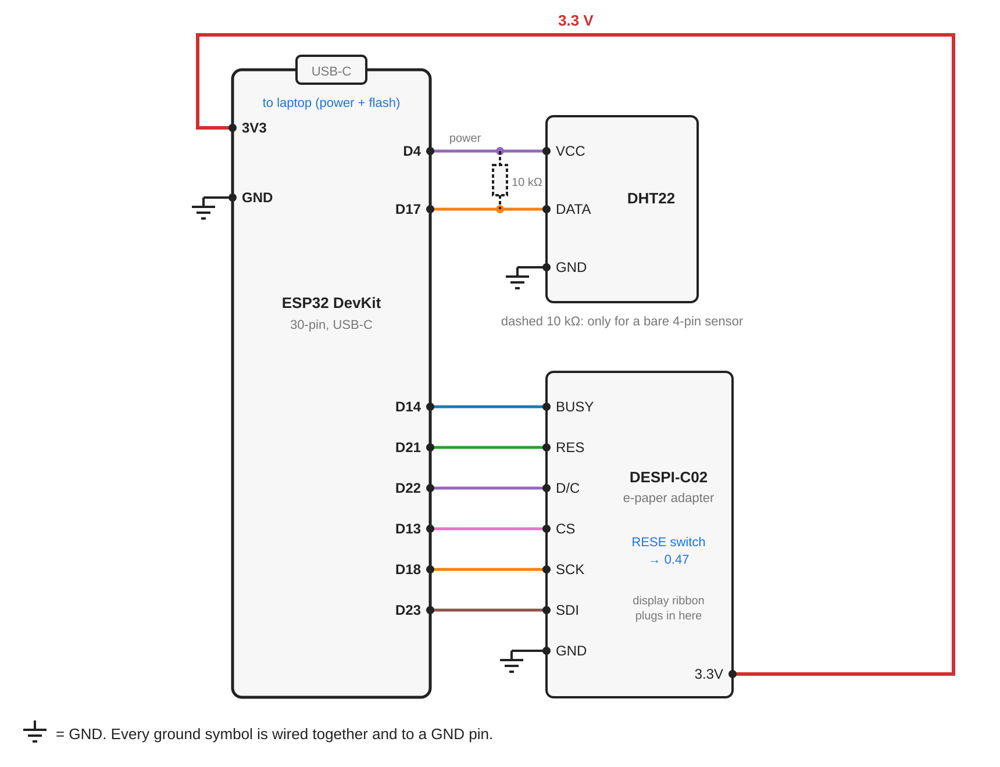
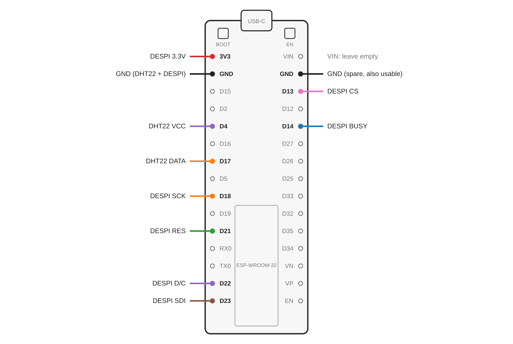
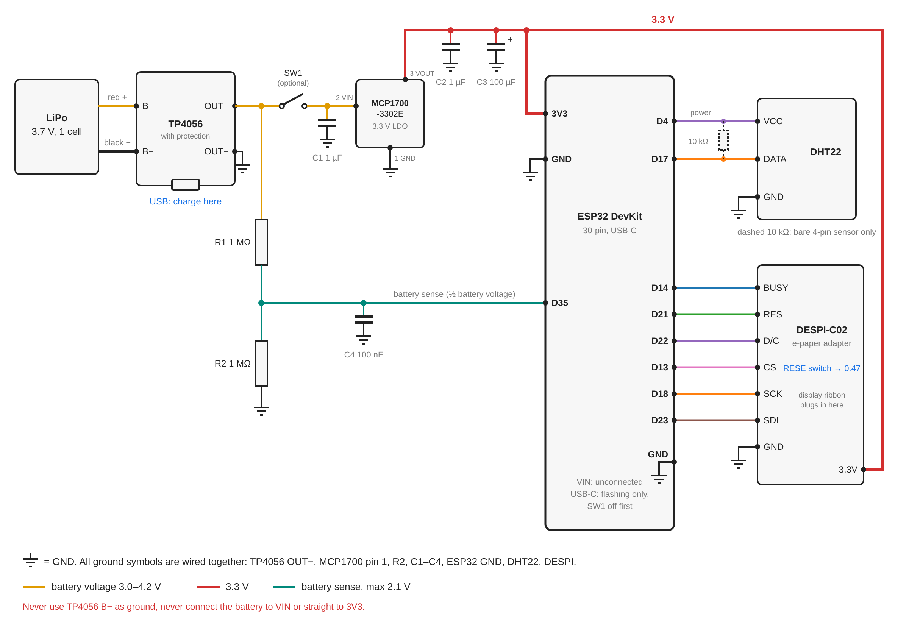
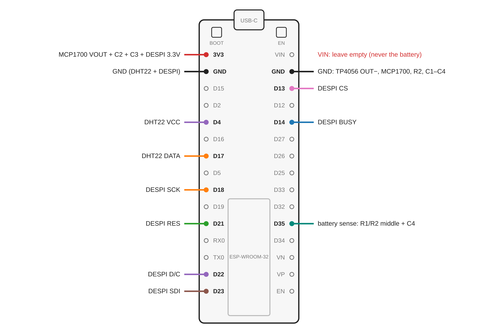

# ESP32 DevKit build (30-pin, USB-C) with DHT22

This build replaces the project's recommended FireBeetle 2 ESP32-E with a
generic 30-pin ESP32 DevKit (ESP-WROOM-32 module, USB-C) and the BME280 with a
DHT22. It comes in two variants:

- [USB-powered build](#usb-powered-build): the DevKit runs from its own USB-C
  port. No extra parts.
- [Battery build](#battery-build): a LiPo with a TP4056 charger, a low-dropout
  3.3 V regulator and a battery-voltage divider replace the FireBeetle's
  built-in battery circuit.

The display and sensor wiring is identical in both variants.

## Hardware (both variants)

| Part | Notes |
|---|---|
| ESP32 DevKit, 30 pins, USB-C | ESP-WROOM-32 module, pins labelled `Dxx` = GPIOxx |
| DESPI-C02 e-paper adapter | RESE switch set to **0.47** |
| 7.5" black/white e-paper panel, 800×480 | `DISP_BW_V2` in `config.h` |
| DHT22 temperature/humidity sensor | 3-pin module or bare 4-pin sensor |

## USB-powered build

The DevKit's USB-C port powers the board, and its onboard regulator supplies
the display adapter through the 3V3 pin. `BATTERY_MONITORING` is `0`.





| From | To ESP32 pin |
|---|---|
| DESPI BUSY | D14 |
| DESPI RES | D21 |
| DESPI D/C | D22 |
| DESPI CS | D13 |
| DESPI SCK | D18 |
| DESPI SDI | D23 |
| DESPI GND | GND |
| DESPI 3.3V | 3V3 |
| DHT22 VCC | D4 |
| DHT22 DATA | D17 |
| DHT22 GND | GND |

- The DevKit has a GND pin on each side (2nd from the USB-C end); the DHT22
  and the DESPI can each use one.
- The firmware powers the DHT22 from D4 only while reading it.
- A bare 4-pin DHT22 (grille facing you, pins down: VCC, DATA, unused, GND)
  needs a 10 kΩ pull-up between DATA and the sensor's VCC (D4). Connecting the
  pull-up to 3V3 instead leaks current through the unpowered sensor during
  deep sleep. 3-pin DHT22 modules include the pull-up.
- VIN stays unconnected.

## Battery build

The DevKit has no LiPo charger and no way to measure the battery voltage. The
battery build adds both, and powers the board through its 3V3 pin from a
separate low-quiescent-current regulator. The display and DHT22 wiring stays
exactly as in the USB-powered build.

### Parts

| Ref | Part | Purpose |
|---|---|---|
| — | 3.7 V single-cell LiPo, e.g. 5000 mAh | Battery |
| — | TP4056 module **with protection** (DW01A + 8205A chips, six pads: B+, B−, OUT+, OUT−, plus USB) | Charging, over-discharge and short-circuit protection |
| SW1 | Small slide or toggle switch (optional) | Disconnects the board from the battery, e.g. for flashing |
| U1 | MCP1700-3302E, TO-92 | 3.3 V low-dropout regulator, 1.6 µA quiescent current, 250 mA |
| C1, C2 | 1 µF ceramic | Regulator input and output capacitors |
| C3 | 100 µF electrolytic or tantalum, ≥ 6.3 V | Covers Wi-Fi current bursts on the 3.3 V rail |
| R1, R2 | 1 MΩ resistors (1 % tolerance preferred) | Battery-voltage divider |
| C4 | 100 nF ceramic | Stabilises the ADC reading from the high-impedance divider |

### Wiring





Power section:

| From | To |
|---|---|
| LiPo red (+) | TP4056 B+ |
| LiPo black (−) | TP4056 B− |
| TP4056 OUT+ | R1, and SW1 (or directly U1 pin 2 without SW1) |
| SW1 other side | U1 pin 2 (VIN) and C1 |
| U1 pin 3 (VOUT) | ESP32 3V3, DESPI 3.3V, C2, C3 (+) |
| U1 pin 1 (GND) | GND |
| R1 other end | ESP32 D35, R2, C4 |
| R2 other end | GND |
| TP4056 OUT−, C1, C2, C3 (−), C4 | GND |

Display and sensor: same table as in the
[USB-powered build](#usb-powered-build). The only change is on the 3V3 pin,
which is now fed by U1 instead of the DevKit's own regulator.

Ground means one shared ground net: TP4056 OUT−, U1 pin 1, R2, C1–C4, both
ESP32 GND pins, the DHT22 and the DESPI. A breadboard rail or a strip of
perfboard makes the joins easy.

#### MCP1700 pins (TO-92)

With the flat side facing you and the legs pointing down, left to right:
**1 = GND, 2 = VIN, 3 = VOUT** (Microchip datasheet DS20001826F, table 3-1).
Other regulators in the same package, such as the HT7333 or HT7833, use
different pin orders; check the datasheet of the exact part.

#### Why it is wired this way

- **TP4056 OUT− is the ground, not B−.** On a protected module the protection
  MOSFETs sit between B− and OUT−. Taking ground from B− bypasses the
  over-discharge and short-circuit cut-off.
- **The battery never goes to VIN or straight to 3V3.** VIN feeds the
  DevKit's AMS1117 regulator, which needs about 1 V more input than it outputs
  and draws several mA permanently. A full LiPo is 4.2 V, above the ESP32's
  3.6 V maximum, so it cannot go to 3V3 directly either.
- **The divider halves the battery voltage.** `readBatteryVoltage()` in
  `display_utils.cpp` multiplies the ADC reading by 2, which matches two equal
  resistors. A full battery gives 2.1 V at D35, inside the ADC's range with
  11 dB attenuation. The divider draws about 2 µA.
- **D35 is an ADC1 pin.** ADC2 pins cannot be read while Wi-Fi is on.
- **The divider sits before SW1.** D35 still sees the battery voltage while
  SW1 is off and the board runs from USB, so battery monitoring keeps working
  during flashing and testing.
- **C3 on the 3.3 V rail.** Wi-Fi transmit bursts draw up to about 240 mA,
  close to the MCP1700's 250 mA rating. The capacitor supplies the short peaks.

### Assembly and first power-up

1. Check the TP4056 module: six pads and a second small chip next to the
   TP4056 (the DW01A protection IC). Its charge current is set by the `R3`
   resistor, usually 1.2 kΩ = 1 A, which suits batteries of 1000 mAh and more.
2. Solder the battery to B+ and B−. Check polarity with a multimeter before
   soldering; JST battery plugs have no standard polarity.
3. Build the power section (SW1, U1, C1–C3, R1, R2, C4) with the ESP32 **not**
   connected yet.
4. Switch SW1 on and measure against OUT−:
   - TP4056 OUT+: battery voltage, 3.0–4.2 V.
   - U1 pin 3: 3.3 V.
   - R1/R2 junction: half the battery voltage.
5. Switch SW1 off. Connect U1 pin 3 to the ESP32 3V3 pin, the shared ground to
   both ESP32 GND pins, and the R1/R2 junction to D35.
6. Enable battery monitoring and flash (see below), then disconnect USB and
   switch SW1 on.

### Firmware for the battery build

`PIN_BAT_ADC` in `platformio/src/config.cpp` is already `35`. The only change
is in `platformio/include/config.h`:

```c
#define BATTERY_MONITORING 1
```

Then build and flash as described in
[Building and flashing](#building-and-flashing). With monitoring enabled and
nothing connected to D35, the firmware reads about 0 V, treats the battery as
critically low and hibernates; set it back to `0` for the USB-powered build.

The serial monitor prints the measured voltage on every wake-up:

```
Battery voltage: 3987mv
```

Compare it with a multimeter reading at TP4056 OUT+. A difference of
50–100 mV comes from resistor tolerance and ADC accuracy. The firmware's
thresholds are set in `config.cpp`:

| Constant | Value | Behaviour at or below the value |
|---|---|---|
| `WARN_BATTERY_VOLTAGE` | 3535 mV (~20 %) | Battery status drawn in the accent colour (3-colour and 7-colour panels only; no effect on this black/white panel) |
| `LOW_BATTERY_VOLTAGE` | 3462 mV (~10 %) | Shows the low-battery screen once, stops updating, checks every 30 min |
| `VERY_LOW_BATTERY_VOLTAGE` | 3442 mV (~8 %) | Checks every 120 min |
| `CRIT_LOW_BATTERY_VOLTAGE` | 3404 mV (~5 %) | Hibernates until the EN button is pressed |

`MAX_BATTERY_VOLTAGE` (4200 mV) and `MIN_BATTERY_VOLTAGE` (3000 mV) define the
0–100 % range of the battery icon in the status bar. The firmware stops well above the
TP4056's own protection cut-off (about 2.4 V), so the protection circuit only
acts if something else drains the battery.

### Charging

Plug a USB cable into the **TP4056's** port. Its red LED is lit while
charging, the blue or green LED when the battery is full. The weather display
keeps running while charging. Recharge when the low-battery screen appears.

### Flashing with the battery connected

Switch SW1 off (without SW1: disconnect the wire to U1 pin 2), then plug the
DevKit's USB-C in. Otherwise the DevKit's own regulator and U1 both drive the
3.3 V rail. Switch SW1 back on after unplugging USB.

### Battery life

The DevKit keeps drawing current in deep sleep, mostly from its red power LED
(typically 1–3 mA) and its USB-serial chip. Removing the power LED
(desoldering it or scraping its trace) is the largest single improvement.

Rough estimates for a 5000 mAh battery, with updates every 30 minutes from
06:00 to 00:00 (`SLEEP_DURATION`, `BED_TIME`, `WAKE_TIME` in `config.cpp`),
about 13 s awake per update and an assumed average of 100 mA while awake:

| Deep-sleep current of the whole build | Runtime |
|---|---|
| 2 mA (power LED in place) | about 2.5 months |
| 0.3 mA (power LED removed) | about 7 months |
| 0.05 mA | about 10 months |

The actual deep-sleep current is measurable with a multimeter in its mA range
in series with TP4056 OUT+, while the board sleeps. The µA range can drop
enough voltage to reset the board when it wakes up.

### Troubleshooting the battery build

| Symptom | Cause |
|---|---|
| `Brownout detector was triggered` in the serial log | 3.3 V rail sags during Wi-Fi bursts: C3 missing or too small, long thin power wires, or a nearly empty battery |
| Display shows the low-battery screen right after a charge | D35 not connected to the R1/R2 junction, or R1 and R2 are not equal values |
| Board never wakes up again | Battery fell below `CRIT_LOW_BATTERY_VOLTAGE`; charge it and press EN |
| No voltage on U1 pin 3 | U1 pins swapped (check the TO-92 pin order), or SW1 off |

## Rendering the diagrams

The PNGs are rendered from the SVG sources in this folder:

```sh
for f in wiring_connections wiring_pinout wiring_battery_connections wiring_battery_pinout; do
  rsvg-convert -z 2 -o $f.png $f.svg
done
```

## Firmware changes

### `platformio/platformio.ini`
- New `[env:esp32dev]` environment (`board = esp32dev`, 80 MHz CPU,
  `huge_app.csv` partitions), set as `default_envs`.
- The `esp32dev` board variant does not define `LED_BUILTIN`, which
  `disableBuiltinLED()` uses. The environment adds `-DLED_BUILTIN=2`, the
  DevKit's blue LED.
- New library dependency `adafruit/DHT sensor library @ 1.4.7`.

### `platformio/include/config.h`
- New sensor option `SENSOR_DHT22`, selected. `SENSOR_BME280` is commented out.
- The sensor check accepts exactly one of `SENSOR_BME280`, `SENSOR_BME680`,
  `SENSOR_DHT22`.
- `BATTERY_MONITORING` is `0` for the USB-powered build and `1` for the
  battery build.
- Metric units: Celsius, km/h, hPa, kilometres, and millimetres for daily
  precipitation. The hourly graph shows probability of precipitation.
- `LOCALE de_DE`: German display text, day/month names, and `DD.MM.YY` dates
  in the refresh-time line. Weather descriptions come from OpenWeatherMap in
  German.

### `platformio/src/config.cpp`
- `PIN_BAT_ADC = 35` (D35). The FireBeetle 2 ESP32-E uses `A2`.
- New `PIN_DHT_DATA = 17` (D17). `PIN_BME_PWR` (D4) powers whichever sensor is
  selected.
- Location (`LAT`, `LON`, `CITY_STRING`) is set to Paderborn.
- `WIFI_SSID`, `WIFI_PASSWORD` and `OWM_APIKEY` come from `WIFI_SSID_SECRET`,
  `WIFI_PASSWORD_SECRET` and `OWM_APIKEY_SECRET` in
  `platformio/include/secrets.h`, which is gitignored. To set it up on a fresh
  checkout, copy `platformio/include/secrets.h.example` to
  `platformio/include/secrets.h` and fill in the values. Without the file the
  build stops with an error naming it.
- `TIMEZONE = "CET-1CEST,M3.5.0,M10.5.0/3"` (Europe/Berlin, including
  daylight saving time).
- `DATE_FORMAT = "%a, %e. %B"`: the top-right date reads e.g. "Mo, 2. November".

### `platformio/src/main.cpp`
- With `SENSOR_DHT22`, the sensor is powered from `PIN_BME_PWR`, read after a
  2 s power-up delay via the Adafruit DHT library, and a failed read shows
  `DHT22` plus the read-failed text in the status bar. The BME280/BME680 code
  path is unchanged and only compiled when one of those sensors is selected.
- The 2 s delay adds about 2 s of awake time per update.

## Building and flashing

PlatformIO Core is installed with the official installer, which places it in
`~/.platformio/penv`:

```sh
curl -fsSL -o get-platformio.py https://raw.githubusercontent.com/platformio/platformio-core-installer/master/get-platformio.py
python3 get-platformio.py
ln -sf ~/.platformio/penv/bin/pio ~/.local/bin/pio
ln -sf ~/.platformio/penv/bin/platformio ~/.local/bin/platformio
```

On Arch-based systems the USB serial port (`/dev/ttyUSB0`) belongs to the
`uucp` group:

```sh
sudo usermod -aG uucp $USER   # then log out and back in
```

From `platformio/`:

```sh
pio run -e esp32dev -t upload
pio device monitor -b 115200
```

If the upload stalls at `Connecting....`, hold the board's BOOT button until it
continues. After each update the board deep-sleeps; the EN button wakes it for
an immediate refresh.

## OpenWeatherMap

`OWM_ONECALL_VERSION` is `"3.0"`. One Call 3.0 requires the separate
"One Call by Call" subscription (1,000 free calls/day). Without it, the API
returns `401 Unauthorized` and the display shows the "One Call 3.0 API /
401: Unauthorized" error screen, while the Air Pollution API works with the
same key. Setting "Calls per day (no more than)" to 1,000 at
<https://home.openweathermap.org/subscriptions> keeps usage within the free
tier.
